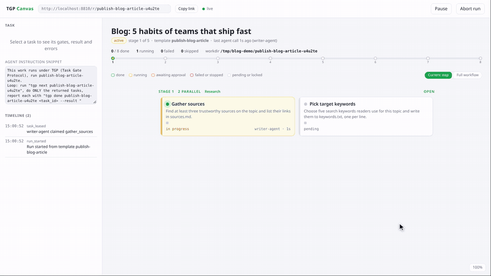
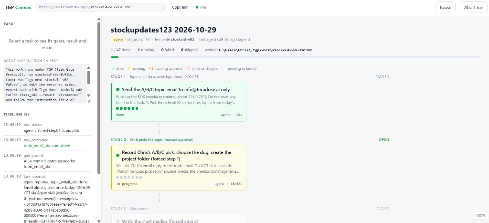
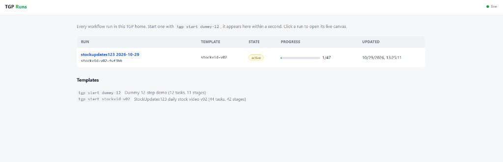

# TGP, Task Gate Protocol

**Public repo:** [github.com/tecadrise-ai/tecadrise-tgp-mcp](https://github.com/tecadrise-ai/tecadrise-tgp-mcp)

## Demo

[](docs/demo/tgp-demo.mp4)

[Watch the full demo video (MP4, 1 minute, 1080p)](docs/demo/tgp-demo.mp4)


TGP forces an LLM agent through a multi step workflow in a fixed, gated order. A workflow is a YAML template of stages and tasks. The engine, not the agent, decides what is open, checks the work, and unlocks the next stage only when every task in the current stage passed its gates. The agent only ever sees the step(s) open right now. A human watches the run live on a canvas in the browser and can approve, pause, retry, skip or abort.

```
$ tgp start dummy-12
{ "run_id": "dummy-12-k3x9qa", "state": "work", "tasks": [ { "task_id": "make_workdir", ... } ], "instruction": "Do ONLY these task(s) now: make_workdir. ..." }
```

## Screenshots

Live run canvas: stages top to bottom, gate dots on each card, agent instruction in the sidebar, pause and abort on the run.



Run list: every workflow run in this TGP home, plus the templates you can start.



## Why

Agents asked to follow a ten step procedure skip steps, do them out of order, claim success without evidence, and lose their place after a context reset. TGP turns the procedure into a state machine the agent has to talk to:

- **Hidden future.** Responses never contain titles or details of locked stages, so there is nothing to work ahead on.
- **Stage gate.** A stage opens only when every task of the previous stage is completed or skipped.
- **Engine evaluated gates.** On `done` the engine checks files, JSON, regexes, commands, media durations or the reported text itself. A failing check keeps the task open and says exactly what is wrong.
- **Stop on fail.** A failed task blocks the run until a human retries or skips it.
- **Idempotent `next`.** After any context loss, `tgp next <run>` puts the agent back exactly where it was.
- **Everything visible.** Each call, report, gate result and human action is in an append only event log shown on the canvas.

### The honest limit

TGP cannot make an agent use it. An agent can ignore the tool and just do whatever it wants in the shell. What TGP guarantees is narrower and still useful: the engine refuses to unlock or accept anything that did not pass its gates, and every skipped, failed or missing step is visible to the human on the canvas and in the event log. Pair it with an instruction to the agent (see `docs/AGENT_SKILL.md`) and with gates that check real outputs, not just the agent's words.

## Install

Requirements: Node.js 20 or newer. `ffprobe` only if you use `media_duration` gates. No root, no Docker, no native modules (the only dependency is the `yaml` parser).

```
git clone https://github.com/tecadrise-ai/tecadrise-tgp-mcp.git tgp && cd tgp && npm install
ln -sf "$PWD/bin/tgp.js" ~/.local/bin/tgp     # or: npm link
tgp templates --pretty
```

On this box it is installed at `/home/box/.local/bin/tgp` (symlink to `/workspace/tgp/bin/tgp.js`).

Data lives in `TGP_HOME` (default `~/.tgp`): `runs/<run_id>/run.json` (state), `events.jsonl` (event log), `logs/` (command gate output).

## Windows

Needs Node 22 or newer (Node 20 cannot expand the test glob under cmd) and git. Everything else is plain Node, no native modules.

Install (PowerShell, in the project folder, for example `C:\TecAdRise\projects-git\tgp-mcp`):

```powershell
npm install
npm test
npm link            # puts tgp on PATH (tgp.cmd / tgp.ps1 in %APPDATA%\npm)
tgp --help
```

If `npm link` is not possible, use the `tgp.cmd` in the project folder instead (`.\tgp.cmd start dummy-12`), or add the folder to PATH.

Start and stop the canvas server (hidden, keeps running after the terminal closes, logs to `serve.log` and `serve.err.log` in the project, both git ignored). Double click `start.bat` / `stop.bat`, or from a terminal:

```powershell
start.bat -NoBrowser                                                            # same as scripts\start-server.ps1 -NoBrowser
stop.bat
powershell -ExecutionPolicy Bypass -File scripts\start-server.ps1               # starts it if needed, opens the run list
powershell -ExecutionPolicy Bypass -File scripts\start-server.ps1 -NoBrowser
powershell -ExecutionPolicy Bypass -File scripts\stop-server.ps1
```

Port: the scripts and `tgp serve` use `-Port`/`--port`, else `TGP_PORT`, else `"port"` in `%USERPROFILE%\.tgp\config.json`, else 8787. Canvas links in responses follow the same port unless `TGP_PUBLIC_URL` (or `"public_url"` in config.json) says otherwise. If another program already listens on 8787, the start script says so and starts nothing. Pick a free port once in the config file:

```powershell
New-Item -ItemType Directory -Force "$env:USERPROFILE\.tgp" | Out-Null
Set-Content "$env:USERPROFILE\.tgp\config.json" '{"port": 8788}'
```

On Chris's PC 8787 belongs to the TecAdRiseBot app, so config.json there sets port 8788 and the canvas is at http://localhost:8788/.

Run a workflow:

```powershell
tgp templates --pretty
tgp start dummy-12 --title "My run"            # prints run_id, workdir and step 1
tgp next <run_id>
tgp done <run_id> <task_id> --result "what I did"
tgp approve <run_id> <task_id>                 # manual gates, or click Approve on the canvas
```

Where things live:

- Data: `TGP_HOME`, default `%USERPROFILE%\.tgp` (`runs\<run_id>\run.json`, `events.jsonl`, `logs\`).
- Workflows: the project `workflows\` folder, plus `%USERPROFILE%\.tgp\workflows`, plus any folders in `TGP_WORKFLOWS` (separate several with `;`, for example `$env:TGP_WORKFLOWS = "C:\work\flows;D:\more"`).
- Workdirs: whatever the template says. `dummy-12` uses `%TEMP%\tgp-dummy\<run_id>`; templates without a `workdir` param use `%USERPROFILE%\.tgp\work\<run_id>`.

Command gates: write new templates with `shell: node` so they work on Windows and Linux alike. Gates without `shell:` run in `cmd.exe` on Windows (set `TGP_SHELL=bash` to use Git Bash, or `powershell`). Windows PowerShell 5 writes a BOM with `-Encoding utf8`; the built-in file gates ignore it, so inline `shell: node` checks should strip it too (`.replace(/^\uFEFF/, '')`).

Notifications: when a step enters `awaiting_approval` (a manual gate), TGP pops up a native Windows toast in the bottom right corner: the run title, the step title and "needs your approval". It looks exactly like a TecAdRiseBot toast (plain title and text, the small app icon and name in the header, no large image or buttons). Clicking it opens `http://localhost:<port>/r/<run_id>`. By default it also toasts when stop on fail blocks a run (a step failed after all its attempts); a toast for a finished run is off by default. It fires from whichever process changed the run (CLI, server or MCP), so it works however the agent drives TGP, and only once per state change.

- Mechanism: the built-in WinRT `ToastNotificationManager`, called from Windows PowerShell 5.1 (`scripts\toast.ps1`) that a small detached, hidden node helper starts, so there is no extra npm dependency and the run never waits for it. It copies TecAdRiseBot: an AppUserModelID in the same `com.tecadrise.*` family (`com.tecadrise.tgp`, registered under `HKCU\Software\Classes\AppUserModelId` with the display name "TGP Task Gate" and the TecAdRise toast icon `resources\toast-icon.png` as the small header icon) and the same toast template Electron builds for TecAdRiseBot (`ToastText02`: title and body only, default duration). Windows Focus assist / Do not disturb can hide toasts; they still land in the notification center.
- Settings in `%USERPROFILE%\.tgp\config.json` (all optional, these are the defaults):

  ```json
  {"port": 8788, "notify": {"approval": true, "failed": true, "done": false}}
  ```

  `"notify": false` turns all toasts off, and so does the env var `TGP_NOTIFY=0`. `npm test` never shows toasts.
- `tgp notify-test` fires a sample toast and reports whether Windows accepted it. Every toast and any error is logged to `%USERPROFILE%\.tgp\notify.log`; a broken notifier only writes to that log and never fails or slows a run.
- On Linux and macOS notifications are a no-op apart from the log line.

From an agent on another machine: the CLI works on the local store only, so an agent elsewhere either

1. runs on this PC (Cursor, a terminal agent, or a remote shell) and calls `tgp` here, or
2. talks to the HTTP API: start the server with `-BindHost 0.0.0.0` (or put an authenticating proxy or tunnel in front, the server itself has no auth) and use `GET /api/v1/runs/<id>/agent` plus the `POST` endpoints listed under HTTP API, or
3. uses `tgp mcp` over a remote stdio transport (for example `ssh pc tgp mcp`).

Set `TGP_PUBLIC_URL` to the address the human opens so canvas links in responses are right.

## Quick start

```
tgp start dummy-12 --pretty          # returns only step 1
tgp serve --port 8787 &              # canvas at http://localhost:8787/r/<run_id> (Windows: start.bat)
tgp next <run_id>                    # the open step(s), then tgp done <run_id> <task_id> --result "..."
```

To hand a run to an agent, give it `docs/AGENT_SKILL.md` (or the snippet shown on the canvas) and the run id.

## CLI reference

All commands print one JSON envelope on stdout. Add `--pretty` for a human readable view.

| command | what it does |
|---|---|
| `tgp templates` | list templates (from `TGP_WORKFLOWS`, `TGP_TEMPLATES`, `$TGP_HOME/workflows`, and the project `workflows/`, first name wins) |
| `tgp start <template> [--param k=v]... [--title "..."] [--worker id]` | create a run, claim and return stage 1 tasks |
| `tgp next <run> [--worker id]` | return your current task(s), claiming open ones. Idempotent |
| `tgp done <run> <task> --result "..." [--output k=v]... [--artifact path]...` | report done, the engine evaluates the gates |
| `tgp fail <run> <task> --error "..."` | report that the task cannot be done |
| `tgp skip <run> <task> --reason "..."` | skip a task the template marks `skippable` |
| `tgp heartbeat <run> <task>` | extend the lease (default 600 s) |
| `tgp status <run>` | read only: open tasks and history of unlocked stages |
| `tgp runs` | list runs |
| `tgp approve <run> <task> [--note]` / `tgp reject <run> <task> [--note]` | human decision on a manual gate |
| `tgp retry <run> <task>` | human: reset a failed task to pending |
| `tgp pause <run>` / `tgp resume <run>` / `tgp abort <run> [--reason]` | human run controls |
| `tgp validate <file.yaml>` | validate a template |
| `tgp serve [--port 8787] [--host 127.0.0.1]` | REST API, SSE and canvas |
| `tgp mcp` | stdio MCP server exposing the agent commands as tools |
| `tgp notify-test` | fire a sample desktop notification (Windows toast, see Windows: Notifications) |

Environment: `TGP_HOME`, `TGP_WORKER` (default worker id, otherwise `agent`), `TGP_PORT` (serve port, default 8787), `TGP_PUBLIC_URL` (canvas base URL put in responses, default `http://localhost:<port>`), `TGP_WORKFLOWS` (extra workflow dirs, a list separated by `;` on Windows and `:` elsewhere; `TGP_TEMPLATES` is the older name and still works), `TGP_SHELL` (shell for `command` gates that do not set `shell:`, default `bash`, `cmd` on Windows). `$TGP_HOME/config.json` can hold `{"port": 8788, "public_url": "..."}` instead of the env vars; env vars win. `TGP_NOTIFY=0` turns desktop notifications off (`"notify"` in config.json picks which events toast).

Exit codes: 0 ok, 1 rejected or error, 2 usage error, 3 gate check failed.

### The envelope

```json
{
  "tgp": 1, "run_id": "dummy-12-k3x9qa", "title": "...", "template": "dummy-12",
  "state": "work",
  "tasks": [ { "task_id": "...", "title": "...", "description": "...", "done_when": "...", "status": "in_progress",
               "stage": 2, "lane": 1, "attempts": 0, "max_attempts": 3, "gates": ["..."], "outputs_required": [],
               "lease_expires_at": "...", "report_with": "tgp done ... --result \"<evidence>\"" } ],
  "progress": { "completed": 1, "skipped": 0, "failed": 0, "total": 12, "stage": 2, "stages_total": 11, "percent": 8 },
  "instruction": "Do ONLY these task(s) now: ...",
  "canvas_url": "http://localhost:8787/r/dummy-12-k3x9qa"
}
```

`state` is one of `work`, `wait` (open work is held by another worker), `awaiting_approval`, `paused`, `blocked`, `done`, `aborted`, `gate_failed` (your report failed its gates, see `report`), `rejected` (the command was refused, see `error`). A `done` response also carries `report: {task_id, status, accepted, gate_failed, gate_results}`. Waiting states carry `retry_after_s`. Errors are always `{code, message, hint}`.

Workers: without `--worker` the caller claims every open task of the stage. With `--worker <id>` each worker claims one task at a time, so several agents can work the lanes of a parallel stage. Tasks are leased; an expired lease puts the task back to pending.

## Templates

```yaml
id: my-flow
title: My flow
params:
  workdir: { default: "{{tmp}}/my-flow/{{run_id}}" }
  site:    { required: true, description: Site to crawl }
settings: { stop_on_fail: true, max_attempts: 3, lease_s: 600 }
stages:
  - title: Fetch
    tasks:
      - id: fetch
        title: Download the page
        description: Save {{site}} to {{workdir}}/page.html
        done_when: page.html exists and is not empty
        outputs: [bytes]
        gates:
          - { type: file_exists, path: "{{workdir}}/page.html", min_bytes: 200 }
  - title: Two lanes in parallel
    tasks:
      - { id: a, title: Lane A, gates: [ ... ] }
      - { id: b, title: Lane B, skippable: true, gates: [ ... ] }
```

Task fields: `id`, `title`, `description`, `done_when`, `skippable`, `max_attempts`, `outputs` (required `--output` keys), `gates`. A flat `tasks:` list (one task per stage) also works.

Substitutions in descriptions and gates: `{{workdir}}`, `{{run_id}}`, `{{tgp_home}}`, `{{tmp}}` (the OS temp dir: `/tmp` on Linux, `%TEMP%` on Windows), any param as `{{name}}` or `{{params.name}}`, and `{{tasks.<id>.outputs.<key>}}` / `{{tasks.<id>.result}}` of a completed earlier task. `tgp validate` checks that output refs point at earlier stages and declared outputs.

## Gate reference

Every gate accepts optional `label` and `hint` (shown to the agent on failure). Relative paths resolve against the workdir.

| type | keys | passes when |
|---|---|---|
| `file_exists` | `path`, `min_bytes`, `kind` (file, dir, any) | path exists, is the right kind, and has at least `min_bytes` |
| `glob_count` | `pattern`, `cwd`, `min`, `max`, `eq`, `include_dirs` | number of matches is in range. Supports `*`, `**`, `?`, `[]`, `{a,b}` |
| `json_has_keys` | `path`, `keys`, `equals` | file is valid JSON, has every key (dotted paths allowed), and `equals` values match (numbers and strings compare loosely). A UTF-8 BOM is ignored |
| `regex_in_file` | `path`, `pattern`, `flags`, `min_matches` | pattern matches at least `min_matches` times (default 1). CRLF is read as LF and a BOM is ignored |
| `command` | `run`, `cwd`, `timeout_s` (60), `expect_exit` (0), `shell` | `run` exits with `expect_exit` inside the timeout. `shell` is `node` (run is a Node.js script, the portable choice), `bash`, `sh`, `cmd`, `powershell`, `pwsh` or `default` (`TGP_SHELL`, else bash on Linux and macOS, cmd on Windows; on Windows `bash` means Git Bash, never WSL). The cwd is the workdir. Output is logged to `runs/<id>/logs/` and shown on the canvas. Env: `TGP_RUN_ID`, `TGP_TASK_ID`, `TGP_WORKDIR`, `TGP_RESULT` |
| `media_duration` | `path`, `min_s`, `max_s` | `ffprobe` duration is within range. ffprobe is optional: without it this gate fails with a clear message and its test is skipped |
| `result_matches` | `pattern`, `flags` | the agent's `--result` text matches |
| `manual` | `prompt` | a human approves (canvas or `tgp approve`). Runs after all automatic gates passed; the task waits in `awaiting_approval` |

A failed gate keeps the task `in_progress`, increments `attempts`, and returns `gate_failed` with each gate's detail and hint. At `max_attempts` (default 3) the task becomes `failed`; with `stop_on_fail` (default) the run is `blocked` until a human retries or skips it. A human `reject` on a manual gate counts as a failed attempt.

## The canvas

`tgp serve --port 8787` serves:

- `/` the run list (live).
- `/r/<run_id>` the canvas: stages flow top to bottom as rows (stage 1 at the top, down arrows between stages), parallel lanes side by side in their row, cards 300 to 420 px wide, locked stages dimmed, the open stage auto scrolls into view unless you scrolled in the last 5 seconds, card colors with a legend above the board: green for done, yellow for running, orange for awaiting approval, red for failed or stopped (a failed step, gate attempts used up, stop on fail, or a step still open when the run was aborted), plain for pending and locked; the status dot before each task title is green for running (blinking) and done, orange (blinking) for awaiting approval, red for failed or stopped and grey for pending and locked; run state chips follow the same colors; per task gate dots. Click a task for its description, gate results (with command output), result, outputs, artifacts, errors and its timeline. Banners for blocked, awaiting approval, paused and agent idle (no agent call for 5 minutes). Controls: pause and resume, abort, approve and reject, retry and skip failed tasks, copy link. Ctrl plus mouse wheel zooms, Ctrl+0 resets. Updates arrive over SSE within about 0.2 s of any CLI call, with a polling fallback.

The server binds to 127.0.0.1 by default; use `--host 0.0.0.0` only on a trusted network, there is no authentication.

### HTTP API

| method and path | |
|---|---|
| `GET /health` | `{ok, tgp_home, runs}` |
| `GET /api/v1/templates` | template list |
| `GET /api/v1/runs`, `POST /api/v1/runs {template, params, title}` | list, start |
| `GET /api/v1/runs/stream` | SSE of the run list |
| `GET /api/v1/runs/:id` | full human snapshot (all stages, locked ones flagged, events) |
| `GET /api/v1/runs/:id/agent?worker=` | the agent view (same as `tgp status`) |
| `GET /api/v1/runs/:id/events` | SSE, `event: snapshot` on every change |
| `GET /api/v1/runs/:id/logs/:file` | a command gate log |
| `POST /api/v1/runs/:id/{pause,resume,abort}` | run controls |
| `POST /api/v1/runs/:id/tasks/:task/{approve,reject,retry,skip}` | task controls, body `{note}` or `{reason}` |

Errors: `{"error": {"code", "message", "hint"}}` with a 4xx status.

## MCP

`tgp mcp` speaks MCP over stdio and exposes `tgp_templates`, `tgp_start`, `tgp_next`, `tgp_done`, `tgp_fail`, `tgp_skip`, `tgp_status`, `tgp_runs`. Human controls are deliberately not exposed. Example client config:

```json
{ "mcpServers": { "tgp": { "command": "tgp", "args": ["mcp"] } } }
```

## Bundled workflows

- `dummy-12`: twelve tiny file tasks in eleven stages. Mixed gates, one two lane parallel stage, one manual approval, output refs, the last step writes `summary.json`. Workdir `{{tmp}}/tgp-dummy/<run_id>` (`/tmp/tgp-dummy/...` on Linux, `%TEMP%\tgp-dummy\...` on Windows). Its command gates use `shell: node`, so it runs unchanged on every OS.

It is the only bundled workflow. Put your own templates in `%USERPROFILE%\.tgp\workflows` (or `~/.tgp/workflows`) or in a folder listed in `TGP_WORKFLOWS`.

## Project layout

```
tgp-mcp/
  bin/tgp.js              CLI entry point
  src/                    engine, gates, store, templates, HTTP server, MCP wrapper, notifier
    cli.js engine.js gates.js mcp.js notify.js server.js store.js template.js util.js
  web/                    the pages the server serves
    runs.html             run list (/)
    canvas.html           run canvas (/r/<run_id>)
  workflows/
    dummy-12.yaml         the one bundled example workflow
  test/                   node:test suites (npm test)
  scripts/                Windows PowerShell helpers
    start-server.ps1 stop-server.ps1 tgp-port.ps1 toast.ps1
  resources/toast-icon.png  icon for Windows toasts
  docs/AGENT_SKILL.md     instructions to hand to an agent
  docs/screenshots/       canvas and run-list screenshots
  _original/              the original PLAN.md and UI mock (reference only)
  PLAN.md                 the plan TGP was built from
  LICENSE                 MIT
  start.bat, stop.bat     start or stop the canvas server on Windows
  tgp.cmd                 run the CLI without npm link on Windows
  package.json, package-lock.json, .gitattributes, .gitignore
```

Generated and ignored: `node_modules/`, `serve.log`, `serve.err.log`, `serve.pid`, `*.log`. Run data is not in the project, it lives in `TGP_HOME`.

## Tests

```
npm test
```

node:test suites: engine semantics (stage gate, hidden future, idempotent next, parallel lanes, stop on fail, max_attempts, output refs, manual approval, pause and abort, leases), every gate type passing and failing, the HTTP and SSE server, the MCP wrapper, the notifier (with a mocked sender: approval, blocked and done toasts, config switches, a throwing sender never breaking a run), and an end to end CLI run of dummy-12 including a rejected premature done and a rejected failing done.

## Design notes and deviations from PLAN.md

- Plain JavaScript (ESM) instead of TypeScript, so it runs with no build step.
- Storage is a JSON file per run plus an append only `events.jsonl`, guarded by a cross process lock directory and atomic renames, instead of SQLite. Node 20 on this machine has no built in SQLite and native modules were ruled out.
- Gates of a `done` report run outside the lock, so a slow command gate does not freeze other workers.
- Unknown and locked task ids return the same `TASK_NOT_AVAILABLE` error so ids of future steps cannot be probed.
- No authentication, no secrets store, no plan editing at runtime, no agent runtime. The snapshot API is the human view and includes locked stages; agent facing commands never do.
